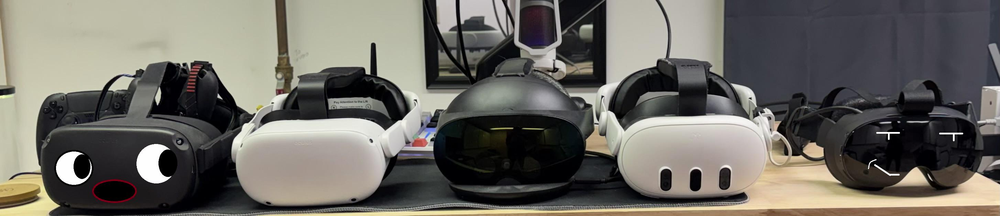

# Quest1-SteamOS

> **Disclaimer: this whole project was entirely vibecoded.** Every line of code, every
> script and this README were written by an AI (Claude), directed and tested on real
> hardware by a human who did not write the code. It works on the headset it was tested on;
> expect rough edges elsewhere, and use it at your own risk.

  
*(Source : [RxVReality](https://www.reddit.com/user/RxVReality/))*

**Native SteamOS on the Oculus Quest 1**, the way the Steam Frame runs it: Valve's SteamOS
(Holo, arm64) boots directly on the headset as the main system, with no Android underneath.
SteamVR runs on the headset itself. Head tracking, the panels, the controllers and the
Wi-Fi are driven natively.

The system starts with `fastboot boot`. The boot image is loaded in RAM, so Meta's system
stays installed and untouched. Rebooting the headset brings it back.

> **Status: experimental, for developers.** There is no way to install it yet. A PC installer
> is being designed ([installer/](installer/)): it downloads SteamOS and Steam from Valve's
> servers and Meta's own Quest 1 update, builds the system image on your PC and flashes the
> headset. Until then this repository is a development log, not a product.

SteamOS, SteamVR, Steam and Meta's tracking software belong to Valve and Meta. None of them
are in this repository or in its releases: the installer downloads them on your own machine,
from Valve's servers and from Meta's last Quest 1 update image.

## What works

| Part | State |
| --- | --- |
| Boot | Linux 4.4 (Meta's kernel with backports for systemd 258), then SteamOS Holo with systemd as PID 1. No Android |
| Steam Frame mode | Steam and SteamVR start in the Steam Frame's mode: Steam recognises the headset as a Steam Frame and its VR UI is the main panel |
| Display | Both panels at 72 Hz with Meta's lens distortion model and chromatic correction, a zero-copy path to the display controller, and a 72 Hz rotational re-projection in [Monado](https://monado.freedesktop.org/) |
| Brightness | SteamVR's own brightness setting (dashboard and Steam's quick menu), applied in the display controller with the panels' factory calibration so both eyes match |
| SteamVR settings | An "Oculus Quest" page in SteamVR's settings, with a button that clears the spatial anchor map |
| Head tracking | 6DoF with Meta's own tracking service, run natively from the headset's partitions |
| Controllers | Touch controllers with Meta's tracking (6DoF, with Meta's prediction), buttons, triggers, grips, sticks and vibration |
| IPD | The physical IPD slider is read live and sets SteamVR's eye separation |
| Audio | Speakers and microphone through PipeWire, with the volume buttons |
| Sensors | The proximity sensor turns the panels off when the headset is removed. The fan keeps running |
| Playspace | The Steam Frame's room setup: floor height and drawing the boundary |
| Passthrough | The Steam Frame's room view with the tracking cameras: 3D view, tint colour, double click on the Steam or Oculus button to toggle it |
| Power | Power button to Steam (sleep, power menu), shutdown and restart from Steam, battery levels, power LED |
| Identity | The system reports itself as SteamOS on an Oculus Quest (os-release, host name) |
| GPU | The Adreno 540 Vulkan driver runs natively through libhybris |
| Access | USB network (`ssh root@192.168.77.1`), a serial console over USB, native Wi-Fi |
| Bluetooth | The WCN3990's Bluetooth with BlueZ, like the Steam Frame: the controller comes up with the headset's own address and finds devices (pairing to test). See [docs/bluetooth.md](docs/bluetooth.md) |
| Desktop mode | The Steam Frame's desktop (nested KDE Plasma with Dolphin, Konsole, Discover...) from Steam's "+" menu, shown as a SteamVR overlay with the laser, scroll and keyboard. See [docs/desktop.md](docs/desktop.md) |

## Work in progress

- **Performance.** On the table SteamVR now holds 72 fps with the dashboard and 68-70 while Steam's UI
  is used (GPU bound); Monado fills the 72 Hz with re-projection. To confirm worn, with the controllers moving.
- **Memory.** Steam, SteamVR and its dashboard fill most of the 4 GB. Already saved: the root
  image's double page cache (direct I/O, ~335 MB), SteamVR's 256 MB GPU upload rings allocated
  on first use (~500 MB, ~250 MB more with the desktop), zstd swap compression. Steam's web
  processes are next.
- **Passthrough.** The depth is a fixed sphere, so near objects are not at their true distance: a depth
  mesh from the bottom camera pair is being written.
- **Sleep.** Suspend to RAM loses Meta's tracking and the sound on resume.
- **Streaming** from a PC (Steam Link), **x86 games** (FEX, Proton), and the
  remaining distortion and chromatic aberration.
- **The installer** (see above): downloads and the image build work end to end; flashing the
  built image is to do.

## How it works

```
fastboot boot ─► Quest kernel 4.4 + initramfs (initrd/init)
                   └─► mounts userdata, loop-mounts /data/steamos/holo.img, switch_root
SteamOS Holo (systemd) ─► the headset's own Android partitions, read-only:
                          firmware, GPU and SyncBoss libraries (run through libhybris)
  Meta's tracking service (cameras, IMU, controllers) ─► q1trackd ─► Monado
  Monado (OpenXR) ─► display controller (both panels), re-projection, proximity
  Steam client (arm64, Steam Frame mode) ─► its VR UI as SteamVR overlays
  SteamVR: vrcompositor ─► Vulkan layer ─► driver_quest1 ─► OpenXR ─► Monado
```

Meta's firmware and libraries are never copied into this repository or into a release. On
the headset they are used from its own partitions, mounted read-only.

## Repository layout

| Path | Contents |
| --- | --- |
| `kernel/` | The kernel patches (`quest1-kernel.patch`, `loop-no-discard-on-ext4.patch`, `cgroup-events-frozen.patch`) on top of Meta's published source, the config additions and the LSE atomics emulation |
| `initrd/` | The initramfs: `init`, a display test, a reboot helper |
| `device/` | Install scripts run on the headset: Android blobs, HALs, Wi-Fi, Monado, Steam session, SteamVR edits, passthrough, audio, power, identity, memory tuning |
| `installer/` | The PC installer: sources, download step, build and flash plan |
| `src/monado/` | The Monado patch: the Quest 1 driver and the display controller target |
| `src/steamvr-quest1/` | The SteamVR driver: display, lens model, IPD, controllers, camera, dashboard tool |
| `src/q1track/` | q1trackd: Meta's head and controller tracking into shared memory for Monado |
| `src/ovrstub/` | Stand-ins for the Android system services Meta's tracking service talks to |
| `src/camtap/` | Camera frames from Meta's tracking service, for passthrough (work in progress) |
| `src/q1grid/` | A full-screen calibration grid for the lens distortion |
| `src/vklayer-steamvr/` | Vulkan layer and shim that make SteamVR run on the Adreno 540 driver |
| `src/xscreen/`, `src/qcam/`, `src/sbimu/`, `src/sbinput/` | Steam screen in VR, camera capture, IMU and controller tests |
| `tools/` | Build scripts (kernel, boot image, system image), helpers on the PC side; `tools/headset-dev/` debugging helpers |
| `release/` | Boot scripts for development (`fastboot boot` only) |
| `docs/` | Research notes, see below |
| `recon/` | The stock headset's configuration (kernel config, properties, partitions) |

## Documentation

| Page | Contents |
| --- | --- |
| [Steam Frame stack](docs/steamframe-stack.md) | How the Steam Frame's software is put together, and what the Quest needs from it |
| [SteamVR port](docs/steamvr-port.md) | Running Valve's arm64 SteamVR on the Quest 1 |
| [Steam on the GPU](docs/steam-gpu.md) | The Steam client UI on the Adreno |
| [Adreno Vulkan extensions](docs/adreno-vk-extensions.md) | The Adreno 540 driver's hidden extensions and timeline semaphores |
| [Headset IMU](docs/syncboss-imu.md) | Reading the IMU through SyncBoss, without Android |
| [Controllers](docs/controllers-native.md) | The Touch controllers through SyncBoss |
| [Lens](docs/quest1-lens.md) | Lens distortion, field of view and geometry |
| [Display path](docs/direct-scanout.md) | From SteamVR's frames to the panels, and the 72 Hz re-projection |
| [Steam Frame mode](docs/frame-mode.md) | Booting into Steam's VR shell like the Steam Frame |
| [Audio](docs/audio.md) | Speakers, microphone and volume buttons without Android |
| [6DoF](docs/tracking-6dof.md) | Running Meta's tracking service natively |
| [Tracking IPC](docs/tracking-ipc.md) | Talking to Meta's tracking service |
| [Passthrough](docs/passthrough.md) | The Steam Frame's room view from the Quest's tracking cameras |
| [Playspace](docs/boundary.md) | Floor, playspace and boundary, and Meta's map persistence |
| [Installer](installer/README.md) | Download, build and flash from a PC |
| [Performance](docs/performance.md) | Where the frame time goes, what was measured and tried |
| [To do](docs/todo.md) | What is left to do (done work moves to the pages above) |
| [SteamOS image](docs/rootfs-build.md) | What the system image holds, and the plan to build and install it reproducibly |
| [Phase 0](docs/phase0-recon.md) | First survey of the headset (in French) |

## Building

The boot image is built from public sources only: Meta's
[Quest kernel](https://github.com/facebookincubator/oculus-linux-kernel), Android's GCC 4.9
toolchain, Debian's BusyBox and this repository. On an x86_64 Debian or Ubuntu machine, or
in WSL:

```sh
tools/build-boot.sh kernel work kernel-out
tools/build-boot.sh image  work kernel-out boot-native-holo.img
```

The [Prerelease workflow](.github/workflows/prerelease.yml) runs the same two commands on
every push to `main`.

The parts that run on the headset (Monado, the SteamVR driver, the Vulkan layer) are built
on the headset or cross-built in WSL. Their `build.sh` scripts and the `device/` scripts
show how.

## Related project

[quest2-steamos](https://github.com/URFAVF3MBOY/quest2-steamos) runs SteamOS on the Quest 2. Its
author allowed this project to reuse its code; where it does, the code says so.

## Safety

- Everything boots with `fastboot boot`. Nothing in this project flashes, erases or
  unlocks a partition yet. The planned installer's full mode will: it replaces Android, and
  never touches the boot chain, the firmware or the headset's own calibration
  ([installer/](installer/README.md)).
- The headset's own Android partitions are only mounted read-only.
- The Linux system lives in a file on the data partition. A factory reset deletes it, and
  the headset is back to stock.
- Back up your headset's partitions before experimenting anyway.

## Legal

This project is not affiliated with, endorsed by or sponsored by Meta or Valve. Oculus,
Quest and Horizon are trademarks of Meta Platforms. Steam, SteamVR, SteamOS and Steam Frame
are trademarks of Valve Corporation.

No firmware, library or software from Meta or Valve is included in this repository or in
its releases. The kernel and its changes are GPL-2.0, like Linux. The Monado patch follows
Monado's license (BSL-1.0).
